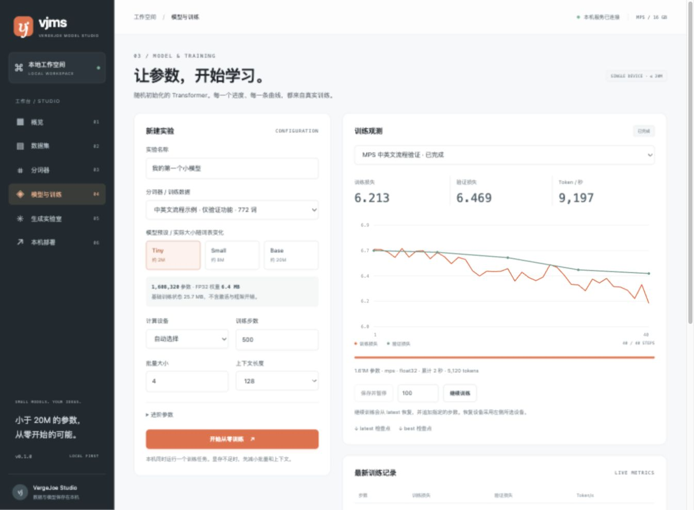

# vjms

**VergeJoe Model Studio** — a local workspace for training and deploying tiny language models from scratch.

从一段中英文文本，到你自己的 Transformer。vjms 把数据准备、分词、建模、训练观测、检查点恢复和本机推理放在同一个工作台中。第一版专注 **≤20M 参数、纯文本、单机、从零预训练**。

## 功能

- 导入 UTF-8 TXT 或粘贴文本，文档去重后固定种子划分训练集与验证集。
- 仅使用训练集学习 Byte-level BPE，支持中英文、未见字符编码和 Token 预览。
- 本项目实现的仅解码器 Transformer：RoPE、RMSNorm、SwiGLU、共享输入输出词嵌入。
- Tiny / Small / Base 三档及自定义配置，实时计算实际参数量，强制 20M 上限。
- 自动选择 CUDA / MPS / CPU；独立训练进程；梯度累积、裁剪、学习率预热。
- 实时损失曲线、吞吐、进度；latest / best 检查点；保存并暂停、恢复和追加训练。
- 浏览器文本续写，支持 temperature、top-k、top-p、重复惩罚。
- 本机 `/v1/completions` 与 `/v1/models`，按需加载检查点。

数据默认保存在当前目录的 `.vjms/`，不会自动上传。首次安装依赖需要联网；正常使用不需要下载外部模型、分词器或网页资源。



## 快速开始

需要 **Python 3.10+**，推荐 **Python 3.12**。系统自带的 Python 3.9 不适用。没有单独的前端构建步骤。

### macOS / Linux

```sh
git clone https://github.com/vergejoe/vjms.git
cd vjms
python3.12 -m venv .venv
source .venv/bin/activate
python -m pip install -e .
vjms
```

打开 <http://127.0.0.1:8765>。Apple Silicon Mac 在系统与 PyTorch 支持时自动使用 MPS；否则使用 CPU。Mac 统一内存与独立显卡显存不能直接等同。

### Windows / NVIDIA

```powershell
git clone https://github.com/vergejoe/vjms.git
cd vjms
py -3.12 -m venv .venv
```

先按 [PyTorch 官方安装选择器](https://pytorch.org/get-started/locally/) 选择 Windows / Pip / Python 和驱动支持的 CUDA 版本，将命令中的 `pip` 替换成 `.\.venv\Scripts\python.exe -m pip` 执行。然后：

```powershell
.\.venv\Scripts\python.exe -m pip install -e .
.\.venv\Scripts\python.exe -m vjms
```

无需激活环境或修改 PowerShell 执行策略。右上角显示 `CUDA` 才说明 GPU 可用；兼容性还取决于显卡型号、驱动和 PyTorch 版本，不能只依据 8GB 显存判断。

完成安装后，也可使用 `start.command`（Mac）或 `start.cmd`（Windows）再次启动。

### 第一次实验

1. **数据集** → 载入中英文示例，或导入自己的文本。
2. **分词器** → 选择数据集，点击“学习词表”。小语料的实际词表可能低于目标数量。
3. **模型与训练** → 选择分词器和 Tiny 预设。试跑可设为 20–50 步、上下文 64、批量 2、梯度累积 1。
4. 观察训练与验证损失；等待完成，或点击“保存并暂停”。
5. **生成实验室** → 选择模型和 Best 检查点，输入提示词。
6. **本机部署** → 复制当前模型的调用示例。

**内置语料只有 40 篇原创简单短文，仅用于功能验证。短暂试跑不能产出实用语言模型。** 较好的效果需要更多高质量数据、充分训练与独立评估。Base 模型侧重续写；第一版没有指令微调、聊天模板或 Qwen 质量对齐承诺。

## 模型与内存

以 **4,096 词表**为例，全部可训练参数均计入预算：

| 预设 | 层数 | 隐藏维度 | 注意力头数 | 前馈维度 | 参数量 |
|---|---:|---:|---:|---:|---:|
| Tiny | 8 | 128 | 4 | 320 | 2,033,792 |
| Small | 9 | 256 | 8 | 704 | 8,278,784 |
| Base | 10 | 384 | 8 | 1,024 | 19,275,648 |

实际大小随词表变化，页面会计算准确值；超过 20M 时拒绝启动。Base 是 vjms 的基础续写模型预设，不指代 Qwen 权重。

默认上下文 128、批量 4、梯度累积 4。20M 参数的 FP32 权重约 80MB；权重、梯度和 Adam 两个状态合计约 320MB。**不包含激活、注意力、logits、临时张量与框架开销，也不是显存需求保证。** 8GB 显存是设计目标，具体配置需实测。

- CUDA：支持时使用 BF16，否则使用带 GradScaler 的 FP16。
- MPS / CPU：使用 FP32，优先兼容性。
- 内存不足：先减少批量和上下文，再减少模型；用梯度累积维持有效批量。
- 速度是训练步吞吐，包含梯度累积，不包含该步的验证和保存耗时。CUDA 内存指标为峰值，MPS 为当前分配量。

## 数据与验证约定

- 支持 UTF-8 / UTF-8 BOM，单次导入上限 32MB。
- 空行分隔文档；没有多个段落时按行划分；至少两篇不同文本。
- 完全重复文档去重后按文档划分。近似重复和语义重复仍需自行清洗。
- 分词器只在训练集上拟合。文档追加结束标记后打包为 Token 流，训练采样连续窗口；第一版不隔离窗口内不同文档之间的注意力。
- 训练与验证划分各自都必须拥有超过上下文长度的 Token，不足时增加数据或缩短上下文。
- 验证损失来自固定种子采样的验证窗口，默认 4 批次，属于抽样估计。不同分词器下的 Token loss / perplexity 不宜直接比较。
- 页面展示最近 2,000 条记录；完整指标保存在 `metrics.jsonl`。

## 暂停与恢复

验证改善时保存 `best.pt`；定期、暂停和完成时保存 `latest.pt`。通过原子替换写入。暂停在当前训练步结束后执行。

“继续训练”从 latest 的实际步数恢复，并追加指定步数；允许更换设备。检查点包含模型、优化器、GradScaler、采样 RNG、训练步数和累计 Token 数。

同一 CPU 配置下有逐参数一致性回归测试；不同设备、精度之间不承诺逐位一致。恢复时清除晚于持久检查点的指标，避免重复步数。

正常关闭服务时会请求保存并暂停；断电或强制结束只能恢复到最近成功写入的检查点。重启会检查残留训练进程，避免同一目录重复启动训练。

## 本机推理 API

服务运行时，Best 检查点自动出现在模型列表中。每次请求按需加载模型，结束后释放引用；训练与推理互斥，以限制小机器的资源争用。

```sh
curl http://127.0.0.1:8765/v1/models

curl http://127.0.0.1:8765/v1/completions \
  -H "Content-Type: application/json" \
  -d '{"model":"YOUR_RUN_ID","prompt":"从前有一只小猫","max_tokens":100,"temperature":0.8,"top_p":0.95}'
```

模型 ID 为实验的 16 位 ID，页面生成可复制示例。支持常用 completions 字段，**不等同于完整 OpenAI API 兼容层**；不支持 streaming、chat completions 或并行推理。完整定义见 `/openapi.json`。`/api/generate` 另支持 latest、top-k、重复惩罚与固定种子。

CLI 固定绑定 `127.0.0.1`，带 Host 和浏览器 Origin 校验。第一版是个人本地工具，无用户认证，不适合直接暴露到局域网或公网。只加载工作台自产检查点，不提供外部 pickle 模型导入。

## 数据目录

```text
.vjms/
├── datasets/<id>/      # 元数据与去重后的 train / validation 文档
├── tokenizers/<id>/    # tokenizer.json、uint16 Token 文件与统计
└── runs/<id>/          # 配置、分词器副本、指标、日志、latest.pt / best.pt
```

```sh
vjms --port 9000 --data-dir /path/to/my-workspace
```

也支持 `VJMS_HOME` 环境变量。请备份整个数据目录；恢复训练需要原数据与分词器。单个 `.pt` 下载用于保留权重与状态，不是独立导出包。同一目录仅允许一个服务实例。

## 开发与验证

```sh
python -m pip install -e '.[dev]'
python -m pytest -q
node --check src/vjms/static/app.js
python scripts/check_device.py --device auto --preset base
```

测试覆盖编码还原、数据隔离、精确参数量、因果掩码、梯度、真实训练子进程、暂停恢复、优化器和 RNG 连续性、推理 API、输入校验及本机访问边界。

提供 [Ubuntu / Windows / macOS CPU 测试的 CI 模板](docs/ci-workflow.example.yml)。具备 workflow 写入权限后，可复制到 `.github/workflows/tests.yml` 启用；当前未自动启用。GPU 需在实际硬件验证。当前开发环境已实测 Apple MPS，Windows CUDA 尚待目标机器验证。

技术结构：FastAPI + PyTorch + Hugging Face Tokenizers，前端为无需构建的 HTML / CSS / JavaScript。全部模型权重随机初始化，不加载外部预训练模型。

参考：[PyTorch](https://pytorch.org/)、[Tokenizers](https://huggingface.co/docs/tokenizers/)、[Qwen2.5 架构](https://huggingface.co/Qwen/Qwen2.5-0.5B)、[TinyStories](https://arxiv.org/abs/2305.07759)。

## License

[MIT](LICENSE)
